# Job Applier

An AI job-application agent that runs inside **Claude Code**. It finds high-quality
product/strategy roles across a curated company watchlist and fills out their
application forms — intelligently, and **never submitting without your
say-so**. Applications run on Greenhouse, Lever and Ashby. Workday sourcing is
**verified live**; the Workday **apply** path has completed one real
application (Capital One, 2026-11-13), but only with a Chrome-extension
fallback for the form widgets the built-in browser could not drive, so it is
**partly verified, not yet routine**.

Claude Code is the reasoner; a local **MCP server** gives it a real browser
(Playwright, **44 tools**), your profile/history/knowledge base, and live jobs from company
career boards. **No LLM API key or cost** in the core flow.

## Quick start

```bash
pip install -r requirements.txt
playwright install chromium
```

Open this project in Claude Code and reload it (loads `.mcp.json`), then:

- `/find-jobs fintech product strategy` — search your watchlist, ranked & filtered.
- `/apply-to-job <url>` — open an application and fill it from your data.
- `/apply-batch <url> <url> …` — queue several applications: answers are
  prepared in parallel, you approve everything (including per-job submit
  consent) in **one** upfront review, then the queue fills and submits
  serially with zero further prompts — anything unexpected is parked with a
  reason instead of interrupting you.
- `/tailor-application <url>` — **on demand**, generate a bespoke resume +
  cover letter for one posting: it re-emphasizes/reorders bullets in your
  `resume.docx` (formatting preserved) and drafts a cover letter in **your own
  writing voice**, saved for the apply flow to pick up automatically.
- **`autonomous` prefix** — prefix the argument of `/find-jobs`,
  `/apply-to-job`, or `/apply-batch` with `autonomous` (e.g.
  `/apply-batch autonomous <url> <url>`) to run **without approval gates** and
  **auto-submit where possible**. Jobs that still need a manual submit
  (spam-reject, visible CAPTCHA, parked fields) are left filled for you. Opt-in
  per run — nothing is ever autonomous unless you say so. See
  [the autonomous flow](#autonomous-mode-hands-off-per-run) below.

All personal data lives in a **profile** under `profiles/<your-id>/` (facts,
criteria, resume, knowledge base, history, application log — see
[Profiles](#profiles-per-user-data) below). Copy
[profiles/_template/](profiles/_template/) to `profiles/<your-id>/`, fill it
in, and you're set; `watchlist.yaml` (the shared company list) stays at the
repo root.

Optionally, keep the job corpus warm without a Claude session:

```bash
python -m src.refresh    # fetch all boards → data/postings.db + data/digest-latest.md
```

> **⚠️ EEO / self-identification data:** a profile may contain voluntary EEO
> self-identification values (gender, race/ethnicity, Hispanic/Latino status,
> veteran status, disability status) in a **separate, local-only
> `profiles/<id>/eeo.yaml`** — gitignored, merged into the profile at read
> time, and never synced or uploaded anywhere. When present the agent
> auto-answers the corresponding *voluntary* self-ID sections on applications.
> Providing it is always optional — delete the values (or use **Remove all**
> on the Applyer Profile page) to have those sections left blank instead.
> The web UI only ever shows *which* questions are answered, never the
> answers. EEO answers are never written to the answer history or the
> application log.

## Profiles (per-user data)

Everything personal is scoped to a profile directory — the repo itself carries
no user data, so it can be cloned by anyone. The active profile is resolved
once per process: an env var for per-session overrides, a local selection file
for the machine default, or simply the only profile present. Legacy
(pre-profile) checkouts keep working until `scripts/migrate_profile.py` moves
their root-level files into `profiles/<id>/`.

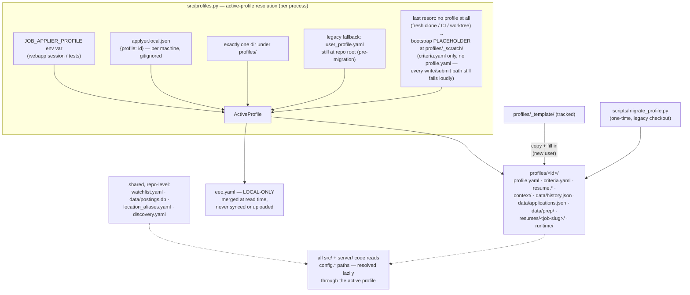

The browser now runs a **persistent Chromium profile** per user
(`profiles/<id>/runtime/browser/`), so ATS logins survive restarts and the
anti-bot fingerprint stays stable instead of resetting every run. Screenshots
land under the profile's `runtime/` too.

**Profiles-less checkout (JOB-131):** `profiles/*` is gitignored, so a fresh
clone or worktree has nothing under it. Rather than every entry point raising
before doing any work, `profiles.active()` bootstraps a clearly-marked
placeholder (`_scratch/`, `placeholder=True`) so read-only pipelines like
`python -m src.refresh` still run. It carries an empty `criteria.yaml` copied
from the template and deliberately no `profile.yaml`, so any path that would
fill or submit a real form keeps raising `FileNotFoundError` instead of
quietly acting as someone with no data. The webapp treats a placeholder as "no
profile" and still shows the launch screen.

## How jobs are discovered

Discovery is split into a **deterministic, LLM-free ingest** (schedulable — it
needs no Claude session) and a **semantic ranking layer** that Claude runs at
`/find-jobs` time over the local store. Salary, years-of-experience, and
seniority are extracted **once per posting at ingest**, so the strict baseline
in `job_criteria.yaml` is enforced as a local query instead of per-search JD
deep-reads.

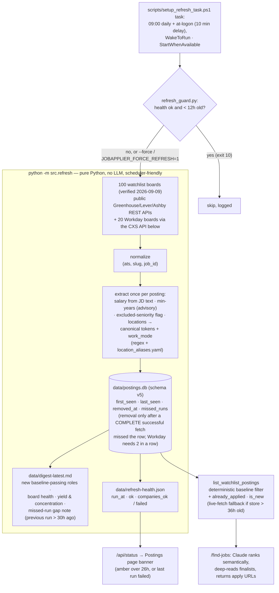

The store is a cache of public data — delete `data/postings.db` and the next
refresh rebuilds it. Schedule the refresh daily (Windows Task Scheduler via
`scripts/refresh.cmd`, or cron/launchd) to get a standing digest of new
matching roles; see the USER_GUIDE. **Reliability (2026-10):** the old task could
not wake the laptop (missed 9/13, 9/18-22, 9/25-30) and Workday boards page
unstably, which produced 100-340 false removals per run. Now
`REMOVAL_GRACE = {"workday": 2}` (a Workday row is removed only after 2
consecutive complete-fetch misses; live probe: paging is stable within a run and
`sortBy` is ignored), each run writes `data/refresh-health.json`,
`scripts/refresh_guard.py` skips a run if one succeeded under 12h ago and rotates
`data\refresh.log`, and `scripts/setup_refresh_task.ps1` registers a wake-aware,
idempotent task. "Allow wake timers" must be enabled in the power plan (it is, on
AC, on this machine as of 2026-10-01). `python -m src.refresh --near-misses` (or
`python scripts/near_misses.py`) audits what the title gate in
`job_criteria.yaml` is silently discarding, in case `acceptable_titles` is
drawn too tightly.

A board dark for 3+ consecutive fetches is flagged `⚠️ STALE` in the digest's
yield table (kept, not hidden — a quiet 404 must not look identical to a
board that legitimately posts nothing) and excluded from yield/concentration
totals; a board dropped from `watchlist.yaml` entirely is swept out of the
store on the next refresh, so a repointed or retired slug never lingers as an
undead active row (JOB-137). A location that names a country but no city
(e.g. a board reporting bare "United States") is kept rather than rejected —
tagged `location_indeterminate` and surfaced as such everywhere it appears
(digest, postings API, the Postings page badge), since a silent board isn't
evidence the role is out of scope (JOB-138).

### Workday boards (M0 — sourcing verified live)

Workday postings are discovered, ranked, and deep-read exactly like any other
board. Applying is covered in the next section. `src/providers/workday.py` pulls a tenant's public
`myworkdayjobs` board through the same keyless JSON API its own SPA calls
(`POST .../wday/cxs/{tenant}/{site}/jobs`, no auth, no cookies). Its shape is
different enough from the REST-list ATSs above to earn its own diagram:

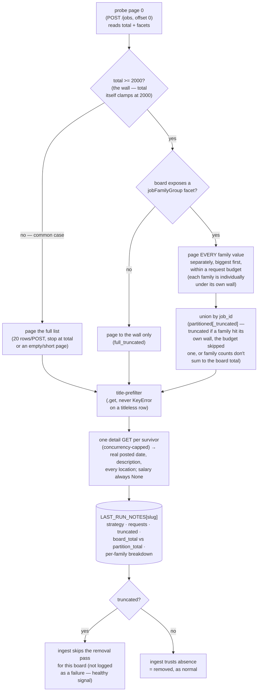

### Workday apply (built, first live run done, partly verified)

On 2026-11-13 the first Workday application was completed and submitted:
Capital One, "Product Manager: Capital One Shopping". It took two browsers. The
built-in browser got through entry, account creation, sign-in and the first
form page, then stalled on the My Experience step (dates, School and Field of
Study search boxes). The application was finished through the **Claude-in-Chrome
extension** in the user's own Chrome, after the user signed in by hand there.
Since then the tools were fixed to handle those widgets, a **Workday account
registry** and a **"technical failure" flag** were added (below), but those
fixes are checked by tests and simulated pages only. They have **not yet been
run against a live tenant**. Also open: the Country Phone Code read-back fix
(`docs/handoff-workday-multiselect.md`).

Entry and sign-in come first. `start_application` clicks only entry controls
(Apply, Apply Manually, "Sign in with email"); it never clicks Autofill with
Resume, Use My Last Application, SSO or submit. `authenticate` signs in or
creates the tenant account from the local-only
`profiles/<id>/secrets/credentials.yaml`, server-side: the password is never
returned, never passes through `fill_field` / `fill_many` (they refuse password
fields), is masked in every read, and is dropped from `capture_submission` and
`save_answer`. Credentials are typed only on Workday hosts. A per-tenant ledger
(`profiles/<id>/runtime/auth_attempts.json`) allows at most one failed sign-in
per tenant per 24h plus a 60s resubmit guard, so a wrong password cannot lock the
account.

**Account registry.** Each Workday company has its own account system, so the
tool keeps a small list of which companies already have an account for your
email (`profiles/<id>/data/workday_accounts.json`; it never stores a password).
`authenticate` reads it: a known working account is signed in to, an unknown
company gets a new account, and a company that says "this account already
exists" is **parked for you to sign in by hand** instead of guessing. The new
read-only tool `list_workday_accounts` shows the list.

**Two kinds of "stuck".** A field with no answer we trust is a **missing
answer**: it comes to you for approval, exactly as before. A field the tool
cannot physically operate (a date box, a search box, a dropdown) is a
**technical failure**: results now carry `technical: true`. After one retry the
agent saves the steps already completed, then hands the job to a **Chrome
fallback lane** that fills the rest in your own Chrome (it never types or reads
a password; if Chrome has not auto-filled the sign-in, it asks you to sign in
there). Missing answers never go to that lane. For Greenhouse, Lever and Ashby
the Chrome lane is only the very last fallback when bot detection blocks a
submit, and is skipped when the company shows a recent application (a
per-company application limit looks the same as a spam rejection).

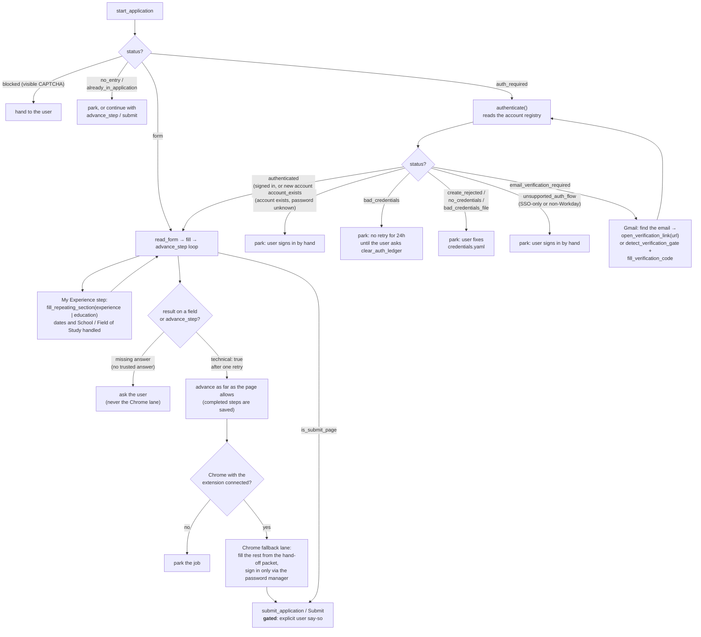

Past sign-in, the generic wizard loop below applies. A form with a
**Next**/**Continue**/**Review** button (distinct from **Submit**) is advanced
programmatically via `advance_step()`; a lone "Apply" on an already-filled tab
counts as a submit, and entry or sign-in pages return `entry_page` / `auth_page`
without a click:

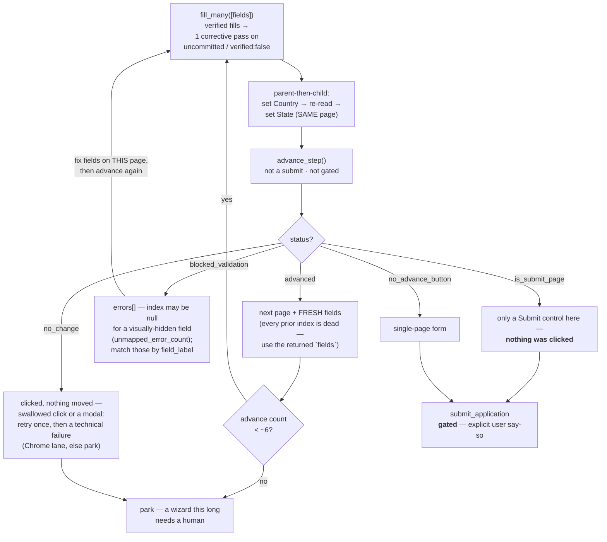

**Dependent fields matter:** Workday's State widget does not exist until Country is
set, and changing Country destroys and recreates it — so the rule is fill the
parent, **re-read the form**, then fill the child from that fresh read. This is
within one page; it has nothing to do with `advance_step`.

Three quirks force this shape: the list endpoint's `limit` maxes at 20;
`offset` is clamped at 2000 (past it the API silently replays page 0); and
`total` is only trustworthy on the first page (2000 there means "2000 or
more", not exactly 2000). Above the wall, the board is fetched by
**partition, not paging**: the board's own `jobFamilyGroup` facet reports a
count per family, and those counts are the true numbers — measured live on
NVIDIA, whose facet counts sum to roughly 2614 while `total` admits only
2000, and whose largest single family (Engineering, 1723) is still
comfortably under the wall on its own. Paging every family separately and
unioning by `job_id` reconstructs the **complete** board with no keyword
guessing about which families matter — a fixed request budget spends on the
biggest families first, and a board still flags `truncated` if a family hits
its own wall, the budget runs out before every family is paged, or the
family counts don't add up to the board's `total`. Workday exposes no salary
anywhere, so every Workday row shows as "salary not listed" — the baseline
already keeps and flags undisclosed-salary rows rather than dropping them,
so this doesn't silently lose roles.

A Workday board's identity — tenant, shard, and site — is packed into the
existing single `slug` column as `"tenant:shard:site"` (e.g.
`capitalone:wd12:Capital_One`), which needed no store migration: the
`(ats, slug, job_id)` primary key already covers it. `scripts/workday_bootstrap.py`
proposes the triples for boards you want to add (see USER_GUIDE §5c for a
worked example) — it never writes `watchlist.yaml` itself.

## Growing the watchlist automatically

The watchlist is curated and hand-approved, but you don't have to find the
companies by hand. `python -m src.discover` (also LLM-free, config in
`discovery.yaml`) enumerates candidate startups from **company-list feeds** —
the **YC company directory** and **VC portfolio job boards** (a16z, USV, … any
board powered by Consider) — and **confirms each against the public ATS APIs**,
counting how many of its roles pass your `job_criteria.yaml` baseline. The
search-engine path that used to rate-limit us is gone: Consider boards hand back
each company's real ATS slug directly, and YC companies are resolved by probing
slug guesses against the same Greenhouse/Ashby/Lever endpoints the refresh
already hits.

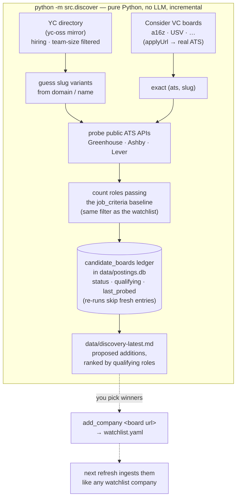

Every run probes up to `max_probes_per_run` candidates (exact Consider slugs
first, then YC guess-probes) and queues the rest, so the cost is bounded and
re-runs only touch new or stale boards. Nothing lands on the watchlist without
your say-so — the report proposes, you `add_company` the ones you want. Full
walkthrough in the USER_GUIDE.

## How a field gets answered

Every form field runs through a strict source cascade — **profile → history →
context** — where the first hit wins and precision decreases (and gating
increases) down the stack. Approved and submitted answers flow back into
history, so the system compounds with every application.

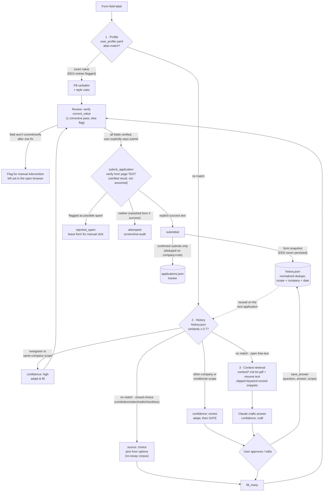

**Verified fills:** `fill_field` and `fill_many` now return `verified: true|false|null` plus `observed_value` to confirm each field actually accepted the input. A proven failure on a pick-from-a-list field returns `status: "uncommitted"` for safe error handling — the Review step has a real machine-readable signal instead of guessing from absence of errors.

- **Profile** (deterministic): ~30 curated facts matched by alias phrases;
  filled verbatim, never re-stored. EEO self-ID values are flagged and only
  used in voluntary self-ID sections.
- **History** (probabilistic, vetted): your own past answers, fuzzy-matched
  and scope-gated — only evergreen or same-company matches auto-fill;
  everything else needs approval.
- **Context + resume** (generative, always gated): paragraph chunks scored by
  keyword overlap; Claude writes from the snippets and pauses for approval.
  The resume text is just another retrieval source here — it has no special
  priority over `context/` files.

## Tailoring a resume + cover letter (on demand)

Response rate — not just apply speed — is the highest-leverage lever, so
`/tailor-application <url>` produces a **bespoke resume and cover letter for one
posting**. It is explicitly invoked, never part of the normal apply flow, and
follows the same "Claude reasons, tools are hands" split: Python reads the base
`.docx`, applies the edits Claude decides, exports the PDF, and gathers your own
past cover letters as voice exemplars — **no LLM API key**.

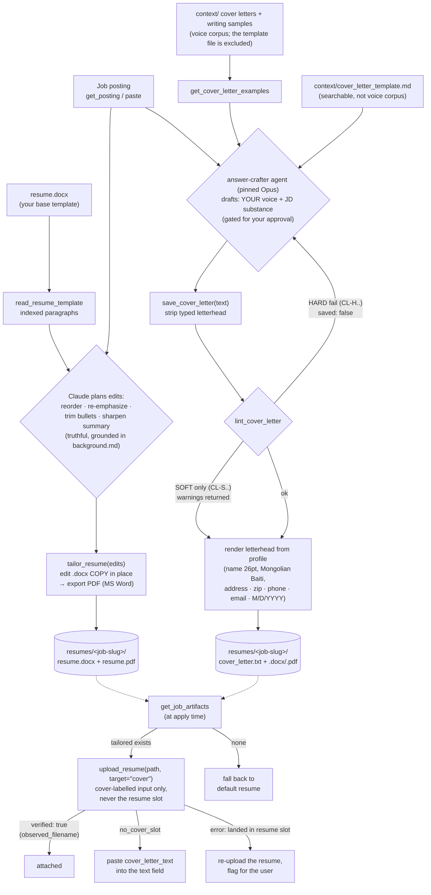

The job folder is keyed off the **same `(company, role)` identity**
`applications.json` dedupes on, so `/apply-to-job` and `/apply-batch`
automatically use the tailored artifacts when they exist and the default resume
otherwise. Drop a `resume.docx` in your profile directory to enable resume tailoring
(the cover-letter half works from `context/` alone). PDF export is
cross-platform: it uses Microsoft Word when present (Windows or macOS) and
falls back to LibreOffice (`soffice`, any OS, no Word needed); if neither is
installed the tailored `.docx` is still saved to export manually.

**Cover-letter pipeline (2026-10).** The letter follows a written template,
`context/cover_letter_template.md` (derived from your own letters; the generic
version ships in `profiles/_template/context/`). It is excluded from the voice
corpus but stays searchable. The letterhead is **rendered by code** from profile
fields (`full_name`, `address`, `city`, `state` as an abbreviation, `zip`,
`phone`, `email`, today's date as M/D/YYYY), so a letterhead typed by the model is
stripped; an optional `cover_letter_template.docx` with `{{placeholders}}` in the
profile root overrides the generated layout. `save_cover_letter` lints first:
HARD rules (`COVER_LINT_RULES` in `src/tailor.py`: salutation and sign-off, no
dashes, no parentheticals, no contact details or placeholders in the body, 270-460
words, 3-6 paragraphs) refuse the save and return `{saved: false, lint}`; SOFT
rules (word band 295-425, canonical opener/closer, AI-tell phrasing) only warn.
`force=True` overrides, only with your OK. The `lint_text` tool applies the same
style rules to any free-text answer before it is filled. All non-verbatim
drafting runs through `.claude/agents/answer-crafter.md`, pinned to **Opus**, and
the web chat session also uses `model="opus"` (webchat usage rows log the model).
In the web app, `/tailor-application` is queued **one role at a time**: an "Up
next" list advances with a Continue button after you approve each result.

**Greenhouse upload fix.** Greenhouse hides both file inputs and the old
auto-locator scored any "cover" container 0, so a cover letter could overwrite the
resume. `upload_resume(index, path, target="resume"|"cover")` now only puts a
cover upload into a cover-labelled input, returns `no_cover_slot` otherwise, reads
the filename back (`verified`, `observed_filename`), and reports an `error` dict
if a cover letter landed in the resume slot. A first live check failed (the
page removes the file input once a file is attached, so the read-back saw
nothing); the read-back was fixed and verified live on Stripe and Tailscale
forms on 2026-11-13.

## Batch prep — snapshot & routing (how `/apply-batch` stays cheap)

`/apply-batch` is engineered so the per-application token cost stays low even
across a large queue. Two ideas do the work: **snapshot server-side** (the big
form dumps and job descriptions are written straight to disk and never pass
through a model's context), and **route by `freetext_count`** (jobs with no
open-ended field are resolved *inline* with no subagent; only genuine
essay/cover-letter jobs pay for a crafting agent, and those are grouped so the
voice corpus loads once per agent).

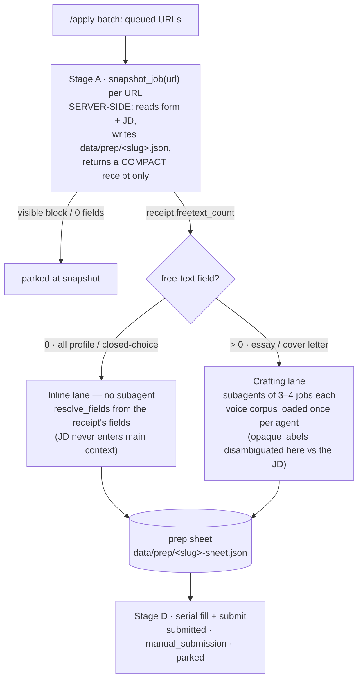

The receipt's `freetext_count` is derived from a `multiline` flag the form
scanner sets on textareas / contenteditable / ARIA textboxes, so the router
never has to read a field payload to decide the lane.

## Autonomous mode (hands-off, per run)

By default the agent gates its answers and **never submits without your say-so**.
Prefix any of the three commands' arguments with **`autonomous`** to opt that one
run into full hands-off execution: it resolves and fills every answer without
pausing, and **auto-submits where it safely can**. In autonomous `/find-jobs` it
also **auto-selects the top finalists** (default 5, skipping already-applied) and
chains straight into the batch apply — search to submit, end to end.

Autonomous mode removes the **approval gates**, not the **guardrails**. It still
won't fight a stubborn widget (one corrective pass, then park), won't
force-submit past a spam-reject or a visible CAPTCHA, and never fabricates an
answer — anything it can't complete cleanly is left **fully filled** in its tab
for a one-click manual submit, exactly as in gated batch mode.

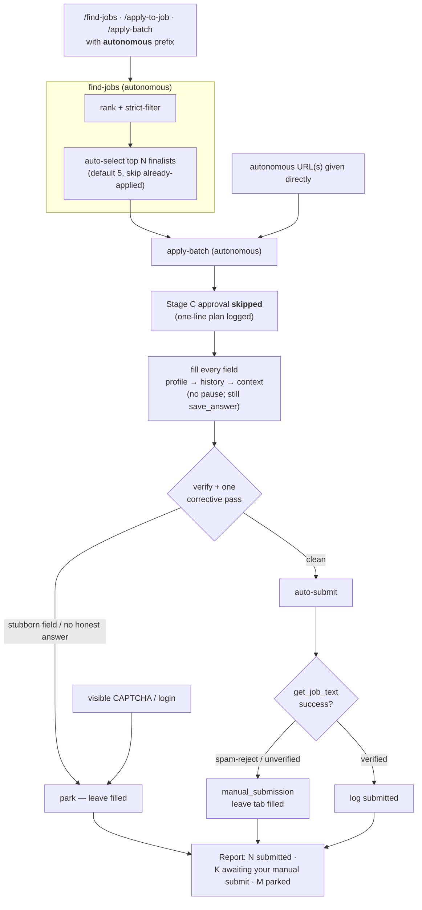

## Web wrapper — Applyer (optional frontend)

The whole agent also has a **desktop web face**: a React SPA (`frontend/`) +
FastAPI backend (`server/`) that wraps the same data files and skills. The
chat surface spawns **real Claude Code sessions in this repo via the Claude
Agent SDK** (your existing Claude Code auth — still no API key), so
`/find-jobs`, `/apply-batch`, and `/tailor-application` run for real, with
tool calls streaming into live run cards. The other surfaces are served from
the same modules the MCP server uses, so they always match what the agent
sees.

```bash
pip install -r requirements.txt        # now includes fastapi/uvicorn/claude-agent-sdk
cd frontend && npm install && npm run build && cd ..
scripts\webapp.cmd                     # serves http://localhost:8765 and opens it
```

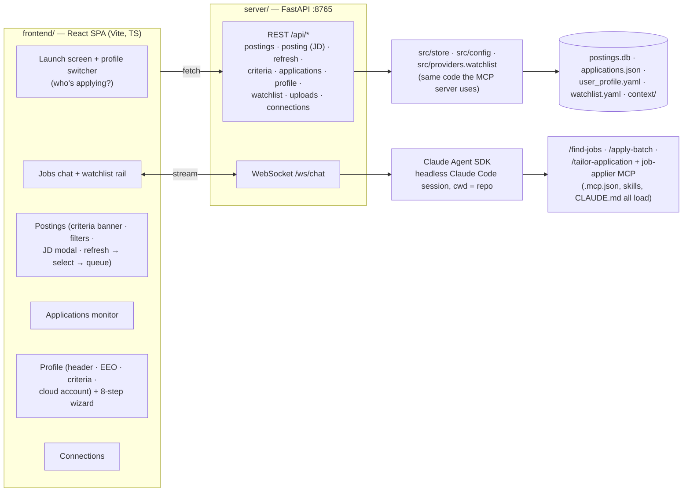

The Postings page filters roles by title, location (normalized tokens — "SF"
and "San Francisco, CA" match together), YoE/salary ranges, and posted date;
a role with a country-only location carries a **LOCATION UNVERIFIED** badge
rather than being silently dropped (JOB-138); a **criteria banner** above the
list names whose criteria scope the feed and how many roles they hide; a chevron opens the full JD in a modal, and a
**Refresh** button runs the same board sweep as `python -m src.refresh` right
from the UI. Selecting postings and confirming the apply modal launches a
**real** `/apply-batch` (the autonomous variant shows an explicit warning
modal first). Write-back from the UI is deliberately narrow: watchlist add
(same logic as `add_company`), whitelisted profile string facts
(comment-preserving edits to the active profile's `profile.yaml`), the
job-criteria card on Profile (comment-preserving edits to the profile's
`criteria.yaml`), resume / context uploads (incl. pasted answers/stories from
the wizard), profile create/switch (below), and the EEO self-ID card —
**write-only**: the UI shows which questions are answered, the edit form
always starts blank, and the values themselves never leave the local
`eeo.yaml`. Connections is status-only — authorization still happens in
Claude Code.

The UI is **profile-aware end to end** (the design handoff's profile-system
round-trip): a launch screen when no profile is active, a sidebar profile
switcher with a confirm step, and an 8-step setup wizard that auto-opens on
an incomplete profile. A **Report bug** button in the sidebar logs issues to
a local `data/bug-reports.jsonl` for the nightly improvement loop to triage.

## Metrics instrumentation (feeds the autonomous dev loop)

The app records the health signals a daily improvement agent (the external
**dev-loop** repo) evaluates each morning. All of it is local and passive:

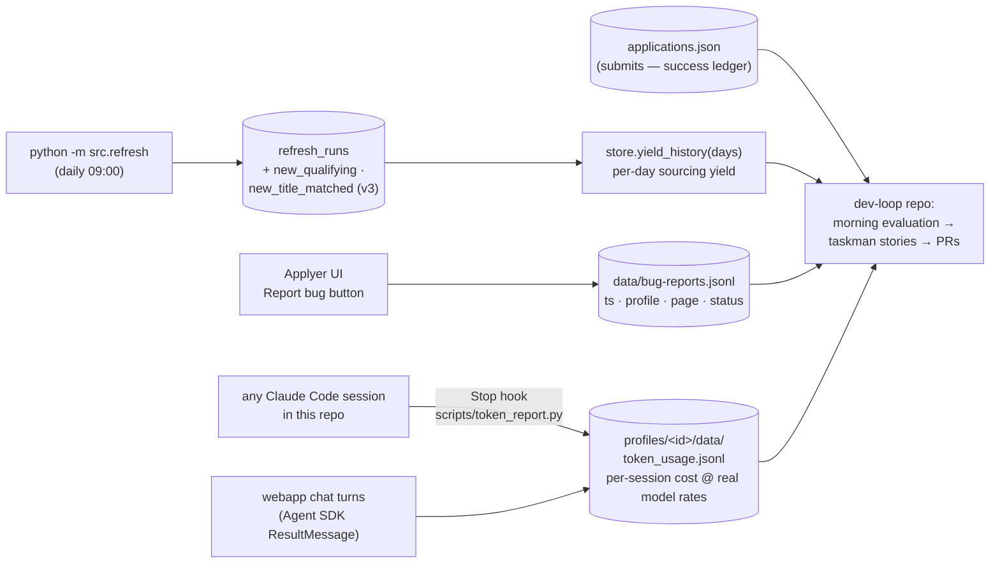

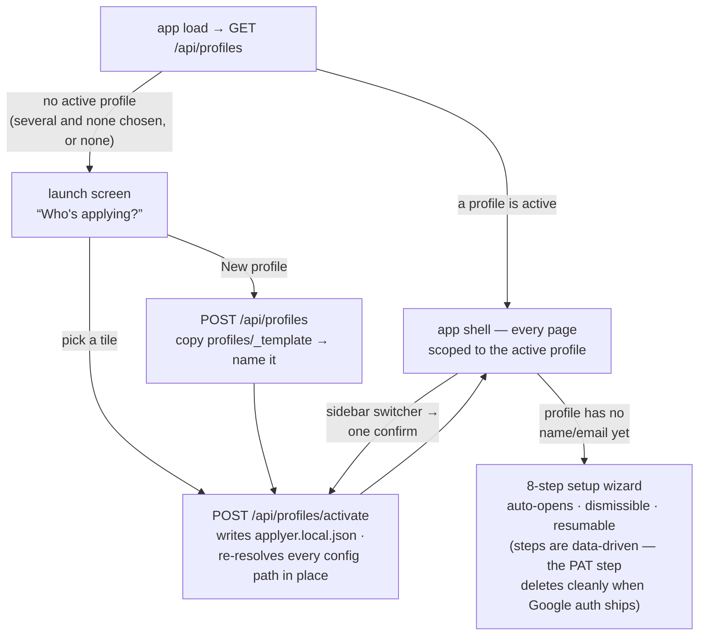

## Continuous integration (merge-damage guard)

`.github/workflows/ci.yml` runs on every push to `main` and every PR. It exists
because PR #11 auto-merged two branches that had edited the **same import
lines**: git resolved them line-wise with no conflict, silently dropping
`profiles as profiles_mod` from `server/data_api.py` (every `/api/profiles`
request 500'd — the launch screen above rendered empty and "New profile" had
nothing behind it) and half-merging `store.yield_stats()`. Neither is a syntax
error, so a syntax check passes on both; the undefined-name check is what
catches them.

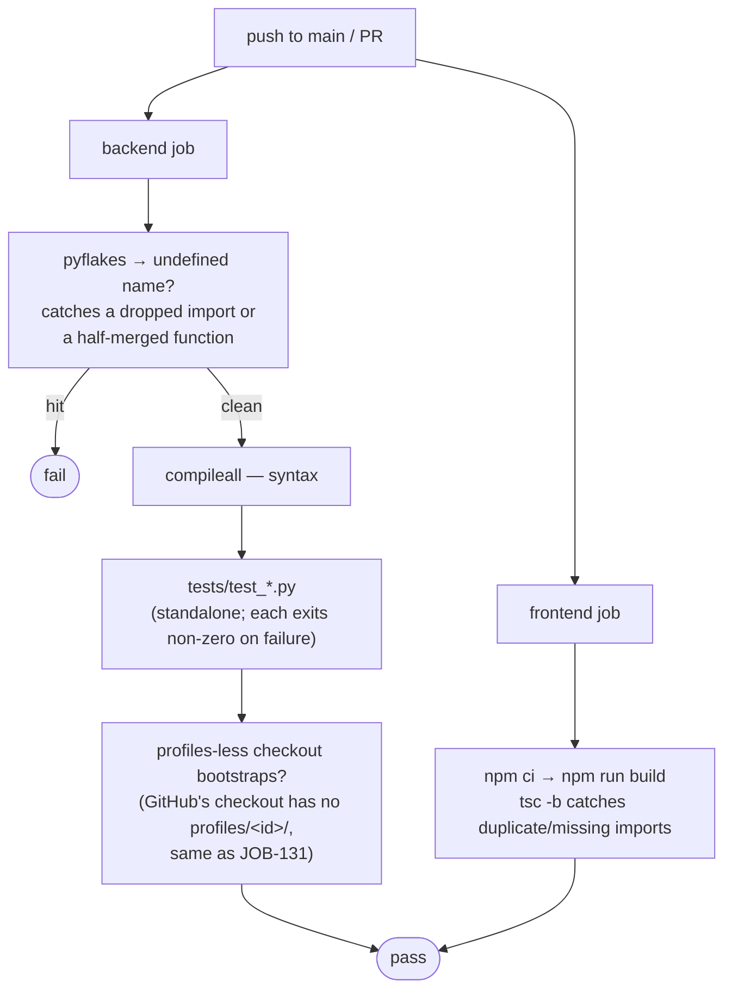

A dropped function that nothing calls yet (`store.yield_history()`, also lost in
that merge) is invisible to all of these — only review catches it.

The Tests step installs `pyyaml` and `httpx`, not just `pyyaml` — measured by
running the suite under an import tracer rather than guessed: `tests/
test_location_scope.py` imports `src.store`, which reaches `src.providers.
watchlist`, which needs `httpx` (and `idna` comes along as an httpx
dependency). A bare `pip install pyyaml` runner goes red on a PR that
otherwise passes locally, because httpx is normally already installed on a
dev machine. The bootstrap-checkout step asserts two things: that
`profiles.active()` returns the placeholder profile (`placeholder=True`,
covered by [JOB-131](#profiles-per-user-data) below) instead of raising, and
that doing so leaves `git status --porcelain` empty — the latter fails loudly
if `profiles/*` ever stops being gitignored and the scratch profile starts
showing up in commits. (The pyflakes step itself writes its report to
`$RUNNER_TEMP`, not the checkout — JOB-135: a stray `./flakes.txt` matched no
`.gitignore` rule and was tripping that same clean-tree assertion on its own
scratch output.)

**Full setup and usage: [USER_GUIDE.md](USER_GUIDE.md).**
