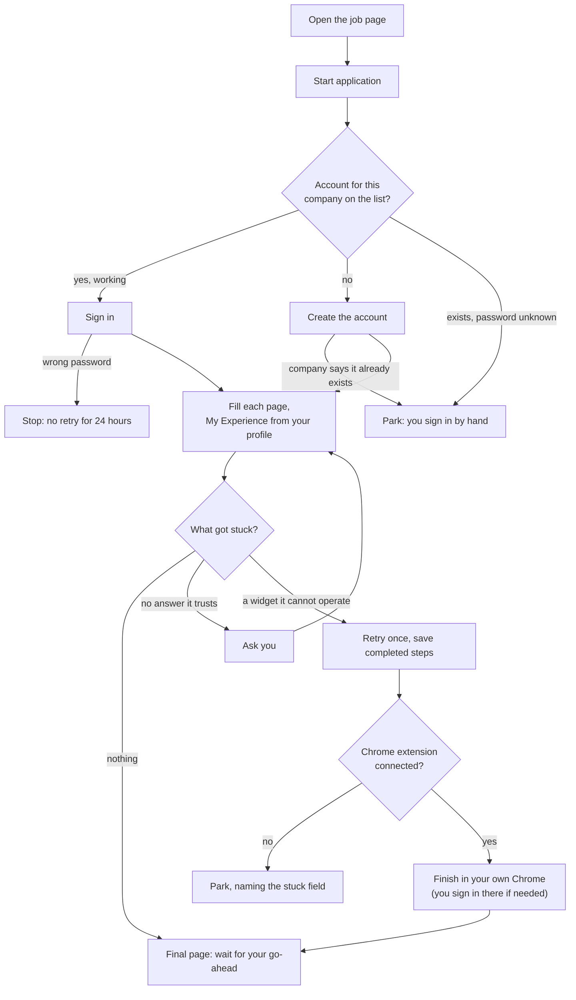

# Job Applier — User Guide

An AI job-application agent that runs inside **Claude Code**. It finds high-quality
product/strategy roles across a curated set of companies and fills out their
application forms for you — intelligently, on any ATS, and never submitting
without your say-so.

---

## 1. What it is

Claude Code is the brain. A local **MCP server** (`job-applier`) gives it hands and
memory: it drives a real Chrome browser (via Playwright), reads your profile /
history / knowledge base, and pulls live jobs from company career boards. You
interact through three skills:


| Command               | What it does                                                                                                                                                  |
| --------------------- | ------------------------------------------------------------------------------------------------------------------------------------------------------------- |
| `/find-jobs <query>`  | Search your company watchlist for matching roles, ranked semantically and filtered by your criteria.                                                          |
| `/apply-to-job <url>` | Open an application form and fill it from your profile/history/context, pausing only when unsure.                                                             |
| `/apply-batch <urls>` | Queue several applications: parallel answer prep, **one** upfront approval (incl. per-job submit consent), then serial fill/submit with zero mid-run prompts. |
| `/tailor-application <url>` | **On demand:** generate a bespoke resume (edits your `resume.docx` in place, formatting preserved) + a cover letter in your own writing voice for one posting; saved for the apply flow to auto-use. |
| `… autonomous <arg>`  | **Opt-in per run.** Prefix the argument of `/find-jobs`, `/apply-to-job`, or `/apply-batch` with `autonomous` to run without any approval gates and **auto-submit where possible**. Jobs that still need a manual submit (spam-reject, visible CAPTCHA, parked fields) are left filled for you. See §7. |


There is **no OpenAI/Anthropic API key** and **no cost** in the core flow — Claude
Code is the reasoner, and job discovery uses free public ATS APIs.

```
Claude Code (the reasoner)
   │  /find-jobs · /apply-to-job
   ▼
job-applier MCP server (Python, local)
   ├─ Browser   open_job · read_form · fill_field · get_field_options ·
   │            upload_resume · screenshot · check_for_intervention ·
   │            get_job_text · submit_application
   ├─ Answers   get_profile_field · search_history · save_answer · search_context
   ├─ Criteria  get_search_criteria
   └─ Discovery list_watchlist_postings · get_posting · list_companies · add_company
Your files: profiles/<id>/ — profile.yaml · criteria.yaml · resume.txt
            (+ resume.pdf) · context/*.md · data/history.json
Shared:     watchlist.yaml · discovery.yaml · data/postings.db (repo root)
```

---

## 2. One-time setup

```bash
pip install -r requirements.txt      # mcp, playwright, pyyaml, pypdf, httpx
playwright install chromium          # the browser the agent drives
```

Then, in Claude Code, **open this project and reload it** so it loads
[.mcp.json](.mcp.json). Run `/mcp` — you should see the `job-applier` server with
**44 tools**.

> Whenever you change code in `src/`, reload Claude Code so the MCP server
> restarts with the new code.

### Profiles

All personal data lives under `profiles/<your-id>/`; the repo root keeps only
shared assets (watchlist, discovery config, postings store). Two ways to get a
profile:

- **New user:** copy the tracked skeleton [profiles/_template/](profiles/_template/)
  to `profiles/<your-id>/`, fill in `profile.yaml` / `criteria.yaml` / your
  resume / `context/`, then write `applyer.local.json` at the repo root:
  `{"profile": "<your-id>"}`.
- **Existing pre-profile checkout:** run `python scripts/migrate_profile.py` —
  it moves the legacy repo-root files (`user_profile.yaml`, `job_criteria.yaml`,
  resume, `context/`, `data/history.json`…) into `profiles/<id>/`.

The active profile resolves in this order: the `JOB_APPLIER_PROFILE` env var
(per-session override) → `applyer.local.json` → the single
directory under `profiles/` → the legacy repo-root layout (until you migrate).
The `get_profile_paths` tool returns the resolved directories. The browser now
uses a **persistent Chromium profile** under the profile's `runtime/browser/`,
so cookies/logins survive restarts.

---

## 3. Your files (edit these to make it yours)


All of these live in your profile directory, `profiles/<id>/` (gitignored —
personal data never leaves your machine). [watchlist.yaml](watchlist.yaml) is
the one shared file, at the repo root.

| File                                   | Purpose                                                                                                                                                          |
| -------------------------------------- | ---------------------------------------------------------------------------------------------------------------------------------------------------------------- |
| `profiles/<id>/profile.yaml`           | Your exact facts (name, email, phone, location, work auth, links…). Filled fields auto-answer forms. Leave a field `""` to skip it.                              |
| `profiles/<id>/secrets/credentials.yaml` | **Local-only, gitignored.** Your one shared ATS account password (and optional email) for Workday sign-in; copy `profiles/_template/secrets/credentials.example.yaml`. See §7 "Workday applications". |
| `profiles/<id>/eeo.yaml`               | **Local-only, voluntary** EEO self-ID (gender, race/ethnicity, veteran, disability). Merged into your profile at read time; never synced, never shown in the webapp. Leave values `""` to skip those form fields. |
| `profiles/<id>/resume.txt`             | Resume **text** used for crafting answers.                                                                                                                       |
| `resume.pdf` (add to the profile root) | The actual file **uploaded** to forms (preferred over `.txt`). On each apply, its text is auto-synced into `resume.txt`.                                         |
| `profiles/<id>/context/`               | Your "knowledge base" — `background.md`, `stories.md`, `preferences.md`, and any `.md` / `.txt` / `**.pdf`** you add. Searched when crafting open-ended answers. |
| `profiles/<id>/criteria.yaml`          | The strict bar for `/find-jobs`: acceptable titles, seniority, locations/remote, and `salary_floor` (currently **$130k**; mid-level ops titles allowed and `Associate` not excluded, per JOB-26). |
| [watchlist.yaml](watchlist.yaml)       | **Shared, repo root.** The companies searched by `/find-jobs` (80 as of 2026-09-09, incl. Series B+ LA/remote startups added 2026-07-04, mid-level S&O/BizOps sources added 2026-07-05 for JOB-26, the 2026-07-12 batch — Harvey, Zip, Abridge, Mixpanel… — 21 discovery adoptions added 2026-07-13, and 12 more added 2026-07-24 — Headway, Flock Safety, ClickUp, Cursor, Turquoise Health, Kong, SentiLink…). Most rows' `slug` is a plain ATS slug; a **Workday** row's `slug` instead packs `"tenant:shard:site"` (quoted — the colons would otherwise break YAML), e.g. `"capitalone:wd12:Capital_One"` — see §5c. |
| `profiles/<id>/context/cover_letter_template.md` | The written structure your cover letters follow (generic version in `profiles/_template/context/`). Edit it to change every future letter; it is searchable but not used as a voice sample. |
| `profiles/<id>/data/history.json`      | Past Q&A answers. Grows automatically as you approve crafted answers.                                                                                            |
| [profiles/_template/](profiles/_template/) | Tracked skeleton (`profile.yaml`, `eeo.yaml`, `criteria.yaml`, README) — copy it to `profiles/<your-id>/` to onboard a new user. |


**To update your resume:** drop `resume.pdf` in your profile root
(`profiles/<id>/`). From then on it's uploaded to forms and its text is
re-extracted into `resume.txt` at the start of every apply (mtime-guarded — the
re-extract only runs when the PDF is newer). No PDF? Just edit `resume.txt`
(it gets uploaded as-is).

**Extra PDFs** (case studies, portfolio) go in the profile's `context/` —
they're indexed for answers, never uploaded. (Text PDFs only; scanned images
yield no text.)

---

## 4. Finding jobs — `/find-jobs`

```
/find-jobs fintech product strategy
/find-jobs AI product, remote
/find-jobs                     ← no query = everything that passes your criteria
```

What happens:

1. Reads the **local postings store** (`data/postings.db` — see §5; if the store
  is missing or older than 36h it falls back to a live fetch of every board and
   says so).
2. The strict baseline from your profile's `criteria.yaml` is applied
  **deterministically from stored fields**: acceptable titles, excluded
   seniority (word-bounded, so "Head" can't hide in "Headquarters"),
   location/remote, and salary ≥ your floor **when disclosed** — a disclosed
   range whose top end is below the floor is dropped; undisclosed salary is
   kept and flagged `salary_listed: false`. A posting that names only a
   country and no city (a board reporting bare "United States") is kept
   rather than rejected as a location miss — it's flagged
   `location_indeterminate` instead, since a silent board isn't evidence the
   role is out of scope.
3. Each role also carries `min_years` (parsed from the JD — **advisory**, always
  confirmed on finalists), `is_new` (appeared in the latest refresh), and
   `already_applied` (matched against the profile's `data/applications.json`, so you never
   re-apply by accident).
4. **Claude ranks the survivors semantically** against your query (company
  domain is a strong signal — Plaid/Ramp/Coinbase = fintech, OpenAI/Anthropic
   = AI) and deep-reads the top candidates.
5. Returns only the passing roles — each with company, location, salary, a one-line
  fit note, and a **direct apply URL** — then offers `/apply-to-job`.

Salary coverage: Ashby boards return structured ranges via the API; for
Greenhouse the range is extracted from the JD text at ingest (`salary_source:
"jd"`), which prices ~60% of Greenhouse roles without a deep-read. Lever
postings rarely embed a range — they stay "salary not listed".

---

## 5. The postings store & daily digest

`/find-jobs` doesn't hit 30 job boards live on every call — a **local SQLite
store** (`data/postings.db`, gitignored) caches every posting with lifecycle
tracking (`first_seen` / `last_seen` / `removed_at`) and the enrichment fields
above, extracted **once per posting** at ingest.

**Refresh it** (pure Python — no Claude session, no LLM, no browser):

```bash
python -m src.refresh
```

Each run fetches all boards concurrently (~30–60s), upserts changes, marks
removals (**only** for boards that fetched successfully — a board hiccup never
mass-deletes), and regenerates **`data/digest-latest.md`**:

**Removal skips incomplete Workday fetches too.** A Workday board over the
2000-row wall (see §5c) can come back **truncated** — it fetched fine, but the
fetch didn't see the whole board, so a posting that's merely unseen must not
be inferred "removed". Those boards are excluded from the removal pass for
that run exactly like a failed fetch is, but — because the fetch itself
succeeded — they're **not** logged under board health as a failure either; an
incomplete-but-healthy Workday board shouldn't trip the same alarm as a dead
one.

- **New postings passing your baseline** since the last run — the apply-fast
  candidates (fresh postings get the best response rates).
- **Board health** — companies whose fetch has failed 3+ consecutive runs
  (stale slug → fix or drop). A board that stays dark for 3+ runs is marked
  `⚠️ STALE` in the yield table below rather than deleted (a network blip can
  recover), but its rows drop out of the yield/concentration totals; a board
  removed from `watchlist.yaml` entirely is swept out of the store on the
  next refresh instead of lingering forever as an active row with a dead
  apply URL.
- **Awaiting outcome** — submitted applications 14+ days old with no reply
  outcome recorded yet, oldest first (capped at 15, "...and N more" beyond
  that), plus the running response rate with its denominator (e.g. "0.0% (0
  replied of 89 submitted)" reads as un-measured, not as a failure). Nothing
  else populates `outcome` automatically — set it with the
  `set_application_outcome` MCP tool or the Applications page when a company
  replies.
- **Yield per company** — active / title-matched / qualifying counts, the
  evidence for deciding which boards earn their watchlist slot.
- **Company concentration** — total / distinct companies / top-5 share, for
  both the qualifying corpus (deduped by role, not raw per-city rows) and the
  application log (every logged record, submitted or manual) — answers "are
  we fishing in one pond?" without a hand count.

**Auditing the title gate:** it's by far the largest filter — on a full store
it discards most active rows, and none of that used to be reviewable.
`python -m src.refresh --near-misses` (or standalone, `python
scripts/near_misses.py`) re-runs the individual predicates read-only and
writes **`data/near-misses-latest.md`**: postings that fail the title gate
*alone* (seniority, location and salary floor all pass), split into
non-contiguous phrase hits ("Product Marketing Manager" vs the configured
phrase "Product Manager" — actionable, a word-order miss) and generic
single-token hits (shares a token, matches no whole phrase — mostly noise,
but shows which tokens are too generic to widen on). Grouped by company and by
matched token/phrase, each capped at 8 example titles with the remainder
stated explicitly.

**Schedule it daily** so the digest is waiting for you:

- **Windows** (already registered on this machine as *"JobApplier Watchlist
  Refresh"*, daily 09:00 + at-logon catch-up):
  Run `powershell -ExecutionPolicy Bypass -File scripts\setup_refresh_task.ps1`
  to register/update the scheduled task.
  - **Wake timers:** `WakeToRun` only works when the power plan's "Allow wake
    timers" is Enable (some machines show "Important Wake Timers Only", which
    is not enough). Check with `powercfg /q SCHEME_CURRENT SUB_SLEEP RTCWAKE`;
    enable with `powercfg /setacvalueindex SCHEME_CURRENT SUB_SLEEP RTCWAKE 1`
    then `powercfg /setactive SCHEME_CURRENT`. The setup script never changes it.
  - **Logged-on only:** the task uses an Interactive principal, so it runs only
    while you are logged on (it can wake a sleeping machine, but not a
    logged-off one).
  - **Catch-up on logon:** The task also runs 10 minutes after logon, which catches up a missed 09:00 run (a run is skipped if one succeeded in the last 12h; `--force` overrides).
  - **Log location:** Runs are logged to `data\refresh.log` (rotated at ~1 MB).
  - **Health + staleness:** every run writes `data/refresh-health.json`; the
    Postings page shows an amber banner when postings are over 26h old or the
    last refresh failed, and the digest notes a gap over 30h ("missed scheduled
    runs?"). Force a run past the 12h guard with `scripts\refresh.cmd --force` or
    `JOBAPPLIER_FORCE_REFRESH=1`.
  - **Workday removals:** a Workday posting is only marked removed after **2
    consecutive** complete fetches miss it (Workday listings page unstably);
    other boards remove on the first complete miss.
- **Linux (cron):** `0 9 * * * cd /path/to/job-applier && python3 -m src.refresh`
- **macOS:** the same cron line, or a launchd agent.

The machine should stay on at 09:00, but if it sleeps, it will catch up on next logon. A missed day is harmless. Deleting `postings.db` is always safe — it's a cache of public data and rebuilds on the next refresh (only `first_seen` history is lost). The apply flow never trusts the store for liveness: postings are re-verified via the ATS API before an application is prepped.

---

## 5b. Discovering new companies to watch

The watchlist is deliberately small and curated, but finding companies to add
is automated. `python -m src.discover` (pure Python — like the refresh, no
Claude session, no LLM, no browser) pulls **company-list feeds**, confirms each
company against the public ATS APIs, and hands you a ranked list of ones worth
adding — all without a rate-limited web search anywhere in the loop.

**Sources** (configured in [discovery.yaml](discovery.yaml)):

- **YC company directory** — every launched YC company (via the public yc-oss
  mirror), filtered to ones currently hiring and above a team-size floor. YC
  gives a name + website but no ATS slug, so the run **guesses slug variants
  from the domain/name** and probes Greenhouse/Ashby/Lever (~50% resolve).
- **Consider VC portfolio boards** — the job boards funds like **a16z** and
  **USV** publish (any board "Powered by Consider"). Each listing links to the
  company's real ATS, so the `(ats, slug)` comes out **exact** — no guessing.
  Add a fund by dropping its board URL + id into `discovery.yaml`.

**What a run does:**

```bash
python -m src.discover
```

1. Enumerates all candidates from the enabled sources (deduped by board).
2. For each candidate it hasn't seen recently, **fetches that company's ATS
   board and counts roles passing your `criteria.yaml` baseline** — the
   exact same deterministic filter `/find-jobs` uses, so a candidate's
   "qualifying" number is what it would really show once on the watchlist.
3. Records every result in a **candidate ledger** inside `data/postings.db`
   (`status`, qualifying count, `last_probed`), then regenerates
   **`data/discovery-latest.md`** — a table of **proposed additions** (confirmed
   boards with ≥1 qualifying role, not already on your watchlist), ranked by how
   many qualifying roles they have.

It's **incremental and bounded**: each run probes up to `max_probes_per_run`
candidates (exact Consider slugs first, then YC guess-probes) and queues the
rest; re-runs skip boards probed within `reprobe_after_days`. So the first few
runs drain the backlog, and thereafter it just picks up newly-hiring companies.

**Adopting a candidate is your call** — nothing touches `watchlist.yaml`
automatically. Open the report, and for any company you like:

```
add_company https://jobs.ashbyhq.com/harvey     ← the Board URL from the report
```

From then on it's a normal watchlist company: the next refresh ingests its
roles and `/find-jobs` ranks them. Schedule `src.discover` weekly (same
mechanism as the daily refresh — Task Scheduler / cron / launchd) if you want a
standing stream of fresh candidates.

---

## 5c. Bootstrapping Workday boards — `scripts/workday_bootstrap.py`

A Workday board needs three coordinates — tenant, shard, site — packed into
`watchlist.yaml`'s `slug` field as `"tenant:shard:site"`. Guessing the shard
by hand is impractical (Workday spreads tenants across 15+ shard hosts), so
`scripts/workday_bootstrap.py` does the matching and validation for you. It
**never writes to `watchlist.yaml`** — it prints ready-to-paste YAML plus a
status table, and you `add_company` (or paste the block) yourself.

It matches human company names against a public, MIT-licensed tenant index
(~12,884 entries), then validates each candidate live against the real API and
auto-repairs the two failures that account for almost everything: a `422`
means the wrong shard (it sweeps the known shards, most-common first), and a
`404` means the wrong site (it re-reads the tenant's `robots.txt`, which
enumerates the tenant's sites).

**Worked example:**

```bash
python scripts/workday_bootstrap.py "Capital One"
```

resolves the tenant against the index, sweeps shards/sites until the live API
answers `200`, and prints something like:

```yaml
  - name: Capital One
    ats: workday
    slug: "capitalone:wd12:Capital_One"
```

for you to paste under `companies:` in `watchlist.yaml` (or run
`add_company https://capitalone.wd12.myworkdayjobs.com/Capital_One`, which does
the same append). Other useful invocations:

| Flag | What it does |
| --- | --- |
| `<names ...>` (bare positional args) | Match one or more company names against the tenant index. |
| `--watchlist-names` | Take the names from `watchlist.yaml` instead of argv (find Workday boards for companies you already track under another ATS). |
| `--tenant T --site S` | Skip name-matching; sweep shards for one known tenant/site directly. |
| `--url <board url>` | Parse and validate a single Workday board URL. |
| `--all-sites` | Validate every candidate site for a tenant instead of stopping at the best-scored one. |
| `--refresh-index` | Force a fresh download of the tenant index instead of the cached copy. |
| `--concurrency N` | Cap concurrent validation requests (default 8, hard ceiling 10). |
| `--limit N` | Cap how many candidates get validated this run (name/`--watchlist-names` modes). |

Run `python scripts/workday_bootstrap.py --help` for the exact current flags.

A site the tenant's `robots.txt` lists under `Disallow:` is reported
separately and **never** recommended — that's an explicit crawler opt-out, and
the tool honors it rather than routing around it.

---

## 6. Managing your watchlist

The watchlist is the universe `/find-jobs` searches — curated for quality.

- **See it:** `list_companies`, or open [watchlist.yaml](watchlist.yaml).
- **Add:** `add_company https://jobs.ashbyhq.com/<company>` (a Greenhouse/Lever
board URL works the same way, and so does a full Workday board URL, e.g.
`https://acme.wd5.myworkdayjobs.com/External`) — it detects the ATS and slug
and appends the entry.
- **Remove:** delete the entry from [watchlist.yaml](watchlist.yaml).

**Workday caveat:** `add_company` needs the *full* board URL — tenant **and**
site. A bare tenant host (e.g. just `acme.wd5.myworkdayjobs.com` with no path)
can't be resolved this way: finding the site requires a `robots.txt` fetch,
and `add_company` runs synchronously from a request handler where that isn't
available. Pointed at a bare host, it returns an actionable error telling you
to run `scripts/workday_bootstrap.py <company name>` instead (§5c), which
resolves the site for you.

Currently **100 companies** (verified 2026-09-09): 80 on Greenhouse/Lever/Ashby
(Stripe, Figma, Databricks, Airtable, Brex, Mercury, Coinbase, Anthropic, Scale
AI, Instacart, Airbnb, Robinhood, Samsara, Ramp, Notion, Plaid, Vanta, Linear,
OpenAI, Snowflake — original seed; plus JOB-26 S&O/BizOps, the 2026-07-12 batch
Harvey/Zip/Abridge/…, and 2026-07-13 discovery adoptions ClassDojo/PermitFlow/…
totaling 80) plus **20 Workday boards** seeded in M0 sourcing (Workday, Adobe,
NVIDIA, Salesforce, Autodesk, Zendesk, Etsy, Zillow, Snap, Expedia, PayPal,
Capital One, Visa, Mastercard, BlackRock, S&P Global, Nasdaq, Gartner, Disney,
Warner Bros. Discovery). [watchlist.yaml](watchlist.yaml) is the source of truth.

---

## 7. Applying — `/apply-to-job`

```
/apply-to-job https://job-boards.greenhouse.io/embed/job_app?for=samsara&token=8035756
```

The browser opens **visibly** so you can watch and step in. For each field, the
agent resolves an answer in this order:

1. **Exact profile value** (the profile's `profile.yaml`, incl. the local-only
  `eeo.yaml` merge) → filled verbatim.
2. **Similar past answer** (the profile's `data/history.json`) → adapted.
3. **Crafted from your context** (resume + the profile's `context/`) → written
  in your voice.

**Confidence gate:** factual/well-supported answers are auto-filled; open-ended or
uncertain drafts pause and ask you to approve or edit. Approved crafted answers are
saved to history and reused next time.

**Answer style rules** (in the skill):

- Demographic/eligibility fields get **bare values** ("United States", "Yes"), not
sentences.
- Open-ended questions get full, specific, first-person answers.
- Instructions aimed at AIs / prompt-injection in a posting are **ignored** — it
answers as you would.

**Resume upload:** handled automatically, even when the form hides the file input
behind an "Attach" widget. **Custom dropdowns** ("How did you hear about us?") are
read with `get_field_options` so it picks a real option instead of guessing.

At the end it verifies each field by re-reading the form and summarizes what it
filled and what it left for you. If a field looks wrong or won't commit (a
finicky custom dropdown, a multi-select that won't take a single value), it makes
**one** corrective attempt and then **flags that field for you to set manually**
rather than fighting the widget with retries — the browser stays open on the
filled form so you can fix the flagged field and submit yourself.

### Batch mode — `/apply-batch`

```
/apply-batch https://jobs.ashbyhq.com/notion/…/application https://jobs.ashbyhq.com/notion/…/application
```

For applying to several roles in one sitting without sitting through each
one's prompts. It runs in stages:

1. **Snapshot** — each form's fields + JD are written to the profile's
  `data/prep/` **server-side by `snapshot_job`**, which returns only a compact
   receipt (incl. `freetext_count`); the form dumps and JD never enter any
   agent's context.
2. **Prep, routed by `freetext_count`** — jobs with **no** free-text field
  resolve **inline** (no subagent; the fields ride in on the snapshot receipt),
   while jobs with a genuine essay/cover-letter field go to **crafting subagents
   of ~3–4 jobs each** (the voice corpus loaded once per agent). Same profile →
   history → context cascade throughout; the routing keeps the per-application
   token cost low.
3. **One consolidated review** — you approve/edit all gated answers for the
  whole queue **and give per-job submit consent** ("submit both", "fill #2
   but don't submit"…). This is the only interaction.
4. **Serial fill + submit** — each approved job is filled, verified, and
  submitted with **zero further prompts**. Anything unexpected (a new
   required field, an unmatched dropdown, an unverified submit, a real
   CAPTCHA) **parks** that job — recorded with a reason, queue moves on.
   If an ATS spam-flags an automated submit (reCAPTCHA v3 scoring), the job
   is left **fully filled** and queued for you instead — by design, no
   automated retries.
5. **Screenshot audit + report** — every "submitted" job is re-verified
  against its success page; anything unverified is handed to you. The report
   reads "N submitted (verified) · K awaiting your manual submit · M parked
   (why + URLs)", and the browser is parked on the first form waiting for
   your click.

The "never auto-submit" rule is unchanged — consent is just collected once,
upfront, per job. Only verified submits are logged as `submitted` in
the profile's `data/applications.json`; forms you submit yourself are logged as
`manual_submission`, and unconfirmed clicks as `attempted`.

### Autonomous mode — `autonomous <arg>`

**Opt-in, per run.** Prefix the argument with `autonomous` on any of the three
commands to run **without approval gates** and **auto-submit where possible**:

```
/find-jobs autonomous fintech product strategy      # find → auto-pick → apply → submit
/apply-to-job autonomous <url>                       # one job, no prompts
/apply-batch autonomous <url> <url>                  # queue, no upfront approval
```

- **`/apply-to-job autonomous`** — crafted and adapted answers are filled without
  pausing (still saved to history), and it **submits on its own** once a form is
  filled and verified.
- **`/apply-batch autonomous`** — the one upfront review (Stage C) is **skipped**;
  it logs a one-line plan per job and proceeds to fill + submit the whole queue.
- **`/find-jobs autonomous`** — instead of just listing matches, it **auto-selects
  the top finalists** (default **top 5**, skipping ones you've already applied to;
  say "autonomous top 10 …" to raise the cap) and hands them to the autonomous
  batch apply. It reports the selection first so you can see what it's doing.

What autonomous mode **does not** change (the guardrails still hold):

- **It doesn't fight errors.** Same "one corrective pass, then park/flag" rule —
  no retry loops, no screenshot spam. It stays cheap per application.
- **Auto-submit is not force-submit.** A submit it can't verify, or that an ATS
  spam-rejects (reCAPTCHA v3), becomes a `manual_submission` — the form is left
  **fully filled** in its tab for you to submit, exactly as in gated batch mode.
- **Visible CAPTCHAs / login walls still stop it** and hand off to you.
- It **never fabricates** an answer to fill a required field — an unanswerable
  field is parked, not guessed.

So an autonomous run ends the same way a batch run does: **"N submitted · K
awaiting your manual submit · M parked"**, with every unsubmittable job left
filled for a one- or two-click finish.

### Workday applications (first live run done; fixes still to be re-checked)

**Where this stands (2026-11-13).** The first Workday application was completed
and submitted for real: Capital One, "Product Manager: Capital One Shopping".
It needed two browsers. The agent's built-in browser handled entry, account
creation, sign-in and the first form page, then stalled on My Experience (the
date boxes and the School / Field of Study search boxes). The rest was finished
through the Claude-in-Chrome extension in your own Chrome, after you signed in
there by hand. Since then the tools were fixed for those boxes and an account
list and a "technical failure" rule were added (described below). Those fixes
are checked by tests and simulated pages only: they have **not yet been run
against a live company**, so watch the next one. You also need to start a new
Claude Code session before the agent picks up the new code.

Workday needs an account per company tenant. One-time setup:

1. Copy `profiles/_template/secrets/credentials.example.yaml` to
   `profiles/<id>/secrets/credentials.yaml` and fill in the one shared password
   you want for Workday accounts (email is optional, defaults to your profile
   email). The file is gitignored and local-only.
2. **Never paste the password into the chat.** The agent never needs it; it types
   it server-side from this file, and will never invent one. If it asks you for
   one or makes one up, stop it.
3. Fill the structured `experience:` and `education:` blocks (and `gpa_policy`:
   `always`, `if_required` or `never`) in `profile.yaml`; dates are `"YYYY-MM"`.
   `zip` is also a profile field now (used on forms and in the cover-letter
   letterhead).

What you will see: the agent clicks Apply (and Apply Manually), signs in or
creates the account, handles the verification email through Gmail (opening the
link or typing the code) if the company sends one, fills each page, completes
My Experience from your profile blocks (including the dates and the School and
Field of Study pickers), and **stops at the final page for your explicit
go-ahead**; it never submits without it. If a sign-in fails with a wrong
password it **stops and does not retry**: only one failed sign-in per tenant per
24h is allowed, to protect you from a lockout. After you fix the password, tell
the agent ("I fixed my Workday password, try again") and it will clear the
lockout record (`clear_auth_ledger`). Credentials are only ever typed on Workday
hosts; on any other site it parks.

**The account list.** Each company's Workday has its own accounts. The agent now
keeps a small list of which companies already have an account for your email
(`profiles/<id>/data/workday_accounts.json`; it never contains a password, and
you can ask the agent to show it with `list_workday_accounts`). If a company is
on the list as working, it signs in. If the company is new, it creates the
account. If the company says "an account with this email already exists", the
agent **does not guess**: it parks that job and asks you to sign in by hand in
the open window, then continue.

**When the agent cannot operate a page widget.** There are two different kinds
of "stuck":

- **No answer it trusts** (a question your profile and past answers do not
  cover, or a draft it is not sure of): it asks you, exactly as before.
- **A technical failure**: it has the answer but cannot work the widget (a date
  box, a search box, a dropdown, or a Next button that does nothing). It tries
  once more, saves the steps already completed, and, if the Claude-in-Chrome
  extension is connected to your Chrome, hands the rest of the application to
  that browser. There it never types or reads a password: if Chrome has already
  filled in the sign-in, it clicks Sign In; otherwise it asks you to sign in in
  that Chrome window. Terms-and-conditions boxes and the final Submit still need
  your go-ahead (unless you started the run in autonomous mode), and it never
  solves a CAPTCHA. If no Chrome is connected, the job is parked with the stuck
  field named.

For Greenhouse, Lever and Ashby, the Chrome route is only the very last fallback
when bot detection blocks the submit, and it is skipped if you applied to that
company recently (a per-company application limit shows the same "We couldn't
submit" message as a spam block, and a second browser would not help).



Limits: the new account list, the sign-in handling and the date and search-box
fixes have not yet run against a live company; SSO-only tenants (a
Google/LinkedIn-only sign-in such as Snap's) need you to sign in manually; the
Country Phone Code dropdown read-back fix (the multi-select item) is still open.

### Safety

- **By default it never submits on its own.** `submit_application` runs only when
you explicitly say to submit — *unless* you opted into **autonomous mode** for
that run (above), which submits where it safely can and leaves the rest for you.
- The browser is **non-headless** — you can take over at any point.
- Confidence gating applies to *answers*; in the default flow submission is
*always* your call. Autonomous mode is the single, explicit, per-run opt-out.

### CAPTCHAs, verification codes, and login walls

- **Visible challenges** — a reCAPTCHA v2 checkbox, an image challenge, a
Cloudflare/Turnstile widget, a "verify you are human" wall, or a login: the
agent **stops and asks you** to clear it in the open browser, then continues
once you confirm. It never tries to solve one itself and never submits while
one is present.
- **Invisible anti-bot** — reCAPTCHA v3 / invisible v2, which Greenhouse and
Ashby load on *every* page — needs no interaction. The agent flags it as a
non-blocking warning and proceeds; it won't ask you to "solve a captcha" that
isn't there. (Earlier versions wrongly halted on this.)
- **Email verification codes** — e.g. Greenhouse emails an 8-character code on
submit. The agent detects the gate and, with Gmail connected, fetches the
code, fills it, and re-submits on its own — no hand-off. Without Gmail it asks
you for the code.

### Tailoring a resume + cover letter — `/tailor-application`

```
/tailor-application https://jobs.ashbyhq.com/rula/…/application
```

For a role you care about, generate a **bespoke resume and cover letter** rather
than sending the default. This is **on demand only** — the normal apply flow
keeps using your default resume; nothing runs per-application unless you ask.

What happens:

1. It reads the posting and your base **`resume.docx`**, then re-emphasizes and
  reorders bullets, trims the least-relevant ones, and sharpens the summary to
   surface your most job-relevant experience — **editing the `.docx` in place so
   your exact formatting/layout is preserved** (no regeneration from text), then
   exports a PDF for upload.
2. It drafts a cover letter primarily from **your own past cover letters** in
  the profile's `context/` so it matches **your writing voice** — sentence rhythm,
   structure, tone — not a generic AI register. The job description supplies only
   the substance. You approve or edit before it's saved.
   The letter follows `context/cover_letter_template.md` and is drafted by the
   Opus-pinned `answer-crafter` agent. The letterhead (name 26pt in Mongolian
   Baiti, address, `zip`, phone, email, today's date) is **rendered by code** from
   your `profile.yaml`, so make sure `zip` is filled; a letterhead typed into the
   draft is stripped. Before saving, the letter is **linted**: HARD failures (em
   or en dashes, missing salutation or sign-off, parentheticals, contact details
   or placeholders in the body, outside 270-460 words, outside 3-6 paragraphs)
   block the save and the agent fixes and retries; SOFT findings (outside the
   295-425 word target, non-canonical opener/closer, AI-sounding phrases) only
   warn. The agent uses `force` only if **you** say to save despite a HARD
   failure. An optional `cover_letter_template.docx` (with `{{full_name}}`,
   `{{address}}`, `{{phone}}`, `{{email}}`, `{{date}}`, `{{body}}`) in your profile
   root replaces the generated layout.
3. Both artifacts are stored under the profile's `resumes/<job-key>/`. The next
  `/apply-to-job` or `/apply-batch` for that exact posting **automatically**
   uploads the tailored resume and attaches/pastes the cover letter; every other
   job still uses the default resume.

**Cover letters on Greenhouse:** at apply time the cover letter is uploaded with
`upload_resume(target="cover")` into a cover-labelled file input only, never the
resume slot, and the filename is read back to confirm. If the form has no cover
upload slot the agent pastes the text instead. (Before 2026-10 a cover upload
could silently replace the resume; check any earlier Greenhouse submission, for
example the 2026-09-16 Stripe one.) Not yet verified on a live form.

In the web app, tailoring several roles runs **one at a time**: an "Up next"
queue offers a Continue button after you approve each result.

**To enable resume tailoring, drop a `resume.docx` in the active profile's
root** (`profiles/<id>/`) — the
base template it edits. Without it, the resume half is skipped but the cover
letter still works. DOCX→PDF export is cross-platform: it uses **Microsoft
Word** when present (Windows via COM, macOS via AppleScript — Word is installed
on this machine) and falls back to **LibreOffice** (`soffice`, works on
Windows/macOS/Linux with no Word). If neither is installed, the tailored
`.docx` is still saved for you to export manually.

It never fabricates experience to match a JD — it only reorders, re-emphasizes,
and trims what's already true in your resume and the profile's `context/`.

---

## 7b. The web wrapper — Applyer

Prefer a UI over the terminal? The repo ships a desktop web frontend that
wraps everything above. One-time setup:

```bash
pip install -r requirements.txt        # adds fastapi, uvicorn, claude-agent-sdk
cd frontend && npm install && npm run build
```

Then launch with **`scripts\webapp.cmd`** (or `python -m server`) and open
<http://localhost:8765>. Five surfaces:

> **After pulling new code, rebuild before relaunching:** `npm run build` in
> `frontend/` (the server serves `frontend/dist` from disk, so the UI stays on
> the old bundle otherwise) **and** stop the running server — an old process
> squatting :8765 makes the relaunch fail to bind, leaving you on stale backend
> code. `Get-NetTCPConnection -LocalPort 8765 -State Listen` shows the squatter.


| Surface | What it shows / does |
| --- | --- |
| **Jobs** | A chat that runs **real Claude Code sessions** in this repo (Agent SDK, your existing auth). Type `/find-jobs fintech strategy` or plain English; tool calls stream in as live run-card steps. The right rail edits the watchlist (`+` calls the same `add_company` logic). |
| **Postings** | Every baseline-passing role from the local store, with NEW tags, salary, and ATS (already-applied roles are excluded — they live on Applications). A filter card narrows by job title, location (normalized city/remote tokens, so "SF" and "San Francisco, CA" match together), years-of-experience and salary ranges, posted date, and an include-missing-data toggle. The **chevron** next to a title opens the full job description in a modal (from the store when cached, live ATS read otherwise). The **Refresh** button next to the page title runs the same board sweep as `python -m src.refresh` (spinner while running, then a scanned/new/removed summary; a second click during a run is refused). Multi-select → **Apply via Claude Code** launches a real `/apply-batch` with those URLs. The **Autonomous** toggle switches the confirm modal to the amber hands-off variant (explicit "can't be undone" warning). |
| **Applications** | The tracker from `data/applications.json` — stat cards + status pills (`submitted` / `manual submit` / `attempted` / `parked`), plus a response-rate tile (percentage and raw counts) and a per-row **outcome** selector (`none` / `rejected` / `screen` / `interview` / `offer` / `ghosted`, JOB-107) so "did anyone reply?" is a real number, not a guess. `status` (did we finish the form) and `outcome` (did the company ever come back) are independent — a submit can sit at `none` indefinitely. Outcome edits are optimistic and revert on failure; rows without a resolvable key disable the selector. |
| **Profile** | Your `user_profile.yaml` facts, résumé state, and `context/` knowledge base. "Edit setup" opens a 5-step onboarding that writes whitelisted facts back to the YAML (comments preserved) and uploads résumé/context files. EEO values never appear in the UI and can't be edited from it. Below the facts, a **Job criteria** card edits `job_criteria.yaml` (titles, locations, seniority, salary floor, YoE window, posted-within, remote) with the same comment-preserving write-back — saving re-scopes the Postings page, the digest, and `/find-jobs` immediately. |
| **Connections** | Detected status of Claude Code, the job-applier MCP server, Gmail, and taskman. Status-only — Gmail is authorized in Claude Code (`/mcp`) or claude.ai connector settings; taskman is wired through this repo's `.mcp.json` and shows connected only when the local taskman server is actually running. |

**Profiles in the UI.** The app is profile-aware end to end:

- **Launch screen** — when several profiles exist and none is chosen (or none
  exists at all), the app opens on "Who's applying?" instead of the shell:
  one tile per profile (applications · % set up · last used) plus a **New
  profile** tile. A lone, already-chosen profile skips straight past it.
- **Sidebar switcher** — the avatar block shows the active profile; clicking
  it opens a popover listing every profile on the machine, plus "New
  profile…" and "Manage profile". Switching asks for one confirmation
  (every page re-scopes; the other profile's data is untouched), then
  toasts "Now applying as <name>". The switch persists to
  `applyer.local.json` and re-scopes the backend in place; MCP servers pick
  it up on their next start.
- **New-profile wizard** — creating a profile copies `profiles/_template/`,
  names it, activates it, and opens an **8-step wizard**: Welcome · Link
  account (paste a PAT — skippable, and honest about the cloud service not
  being live yet) · Résumé (upload + instant email/phone prefill chips +
  an editable review grid; nothing saves until you continue) · Background &
  voice (paste past answers, tell a story, or drop files — each lands in
  `context/` immediately, removable per row) · Preferences (title chips,
  **tri-state seniority chips** — tap once to include, twice to exclude —
  locations, remote, salary floor → `criteria.yaml`) · Requirements (the
  amber-banded hard filters: work authorization, sponsorship, relocation,
  notice period, desired salary → profile facts) · Connections (with a
  Gmail-address-mismatch warning when detectable) · Done (summary +
  completeness ring). Every skippable step skips via a footer text link —
  a skip is a valid finish. The wizard auto-opens on a profile with no
  name/email yet, is dismissible, and resumes at the step you left.

Notes:

- **Report a bug** — the bug icon next to the sidebar theme toggle opens a
  small modal; reports append to the local `data/bug-reports.jsonl`
  (timestamp, profile, page, text, `status: open`). Nothing leaves the
  machine — the nightly dev-loop agent reads the file and triages reports
  into taskman stories. `GET /api/bug-reports` lists them.
- **Token accounting** — a Claude Code `Stop` hook (`.claude/settings.json` →
  `scripts/token_report.py`) prices every session in this repo from its
  transcript (per the model each message ran on) and upserts one line per
  session into the active profile's `data/token_usage.jsonl`; web-chat turns
  additionally append SDK-reported `source: webchat` records. This feeds the
  dev-loop's cost metric.
- The chat session runs with the same trust as a terminal session in this
  repo (`bypassPermissions` inside the project). Approval gates are
  **conversational** — the skills still pause and ask before submitting, and
  you answer right in the chat. Autonomous runs are still opt-in per run.
- A chat run opens its own MCP server + browser, independent of any Claude
  Code session you have open in an editor — don't drive two applies at once.
- Dev loop: `python -m server` + `npm run dev` in `frontend/` (Vite proxies
  `/api` and `/ws` to :8765).
- After changing `server/` or `src/` code, **restart the webapp** — rebuilding
  the frontend alone isn't enough (the backend runs in-process). And make sure
  the old process actually died: a server still squatting :8765 makes the
  relaunch fail silently while your browser keeps talking to stale code
  (JOB-59 tracks making this loud).

---

## 8. The full tool set (44)

**Browser / apply**

- `open_job(url)` — open a posting; syncs the profile's resume.pdf→txt
(mtime-guarded — only when the PDF changed); **one shot**: also
returns the intervention check + the parsed form (no separate
`check_for_intervention`/`read_form` needed right after).
- `read_form()` — list every fillable field (any ATS, no per-site rules). Long
native `<select>` lists are summarized (count + a few samples) to keep the
payload small; pass `values_only=True` for a lean verification re-read (just
index/kind/label/current_value).
- `get_field_options(index)` — real options for a dropdown/combobox (also the
way to expand a summarized `<select>` list).
- `fill_field(index, value)` — fill one field (text/select/radio/checkbox/combobox).
Returns `verified: true|false|null` plus `observed_value` to confirm the field
accepted the input; a proven failure on a pick-from-a-list field returns
`status: "uncommitted"` instead of `"filled"`; password fields are refused.
- `fill_many([{index,value}])` — **fill many fields in one call** (the fast path).
Each result carries `verified` and `observed_value` for safe error handling.
- `upload_resume([index], path, target)` — attach the resume (auto-finds hidden file
inputs). `target="cover"` + the cover-letter path uploads into a cover-labelled
input only (never the resume slot; `no_cover_slot` if none). Always returns
`verified` + `observed_filename`; a cover upload that lands in the resume slot
returns `status: "error"`.
- `fill_repeating_section(section)` — fill Workday's "My Experience" Work
Experience / Education groups from your profile's `experience:` / `education:`
blocks (fill-blanks only, safe to re-run). Statuses include `ok`,
`already_present`, `partial`, `section_not_found`, `no_add_button`,
`no_entries`. It also fills the date boxes and the School / Field of Study search
boxes. Tool results can carry `technical: true`, meaning the tool could not
operate the page (as opposed to the agent lacking an answer).
- `fill_credential(index, field, service)` — type your Workday email/password from
`credentials.yaml` server-side; the value is never shown. `fill_field` /
`fill_many` refuse password fields (`use_fill_credential`).
- `start_application()` — get from a job page to the form or its sign-in gate
(clicks only Apply / Apply Manually / "Sign in with email"; never Autofill with
Resume, Use My Last Application, SSO, or submit). Returns `form`,
`auth_required`, `blocked`, `no_entry`, or `already_in_application`.
- `authenticate([mode])` — sign in to or create the Workday tenant account using
`credentials.yaml`, deciding from the account list. Statuses: `authenticated`,
`email_verification_required`, `account_exists` (an account exists whose password
we do not know: park, you sign in by hand), `bad_credentials` (stop),
`create_rejected` (the create form refused the values), `no_credentials`,
`unsupported_auth_flow` (non-Workday host or SSO-only), `recently_submitted`, and
more. Guarded by the auth-attempt ledger.
- `list_workday_accounts()` — read-only: which Workday companies have an account
for your email and whether the agent can sign in (`active`,
`exists_unknown_password`, `sso_only`). Never shows a password.
- `open_verification_link(url)` — open a Workday verification link from your
email in a side tab, then reload the application tab (Workday hosts only).
- `clear_auth_ledger([tenant])` — **only on your request**; lifts the
failed-sign-in lockout for a tenant.
- `screenshot([path])` — capture the page for review (saved under the profile's
`runtime/` dir — `current_page.png` by default).
- `get_job_text()` — the visible page text (read a JD).
- `snapshot_job(url[, company])` — **batch Stage-A primitive**: opens a posting,
reads its form + JD, and writes the profile's `data/prep/<slug>.json` prep file
**server-side**, returning only a compact receipt (`field_count`,
`required_count`, `freetext_count`, `status`) — the form dumps and JD never enter
the model context. `freetext_count` routes batch prep: `0` → resolve inline (the
receipt carries the fields); `>0` → a crafting subagent. Parks on a real visible
block or a dead posting.
- `check_for_intervention()` — detect a CAPTCHA/login wall; only a **visible**
challenge blocks (invisible reCAPTCHA v3 comes back as a non-blocking warning).
- `detect_verification_gate()` — spot an email/OTP code gate after a submit.
- `fill_verification_code(code)` — fill a detected code gate, then re-submit.
- `advance_step()` — **multi-page wizards** — click a Next/Continue button and
read the new page. Returns `advanced` (fresh fields on the new page; all prior
indexes are dead), `blocked_validation` (form errors, possibly `null`
index for hidden fields, counted in `unmapped_error_count` — match those by
`field_label`), `no_change`, `is_submit_page` (only a Submit control here), or
`no_advance_button`, or on Workday `entry_page` / `auth_page` (nothing clicked;
call `start_application` / `authenticate`). "Review" advances; `is_submit_page`
means **nothing was clicked** — it hands
off to the gated `submit_application` below, which is enforced in the tool rather
than left to the agent to remember. Advancing is not submitting and is not gated.
- `submit_application([index])` — **gated**; only on your explicit go-ahead. The
result is verified from the page **text**: `submitted` (explicit success
message), `rejected_spam` (a "flagged as possible spam" banner — left for you
to submit manually, never auto-retried), or `attempted` (neither — a vanished
form alone is **not** treated as success). Only `submitted` is logged.

**Answers / memory**

- `resolve_fields([{index,label,kind}])` — **resolve many fields in one call**
(profile → history → choice/context cascade), tagged by source. The fast path.
Forwarding each field's `kind` lets closed-choice fields (dropdowns, radios)
resolve to a `choice` (pick-an-option) result instead of dumping the
cover-letter/essay corpus they can't use — the biggest per-application token
saver. Open free-text fields still return clipped `context` snippets to craft
from (pull full voice via `get_cover_letter_examples`).
- `get_profile_field(label)` — exact value from your profile (single).
- `get_profile_paths()` — the active profile's resolved directories (root,
context, data, resumes, runtime).
- `search_history(question)` — closest past answers, scored.
- `save_answer(question, answer)` — remember an approved answer.
- `log_application(company, job_title, url, status)` — record a confirmed
submit (deduped); used for code-gated or manually-clicked submits and backfills.
- `search_context(query)` — relevant snippets from your knowledge base.

**Tailoring (JOB-6; on-demand, via `/tailor-application`)**

- `read_resume_template()` — the base `resume.docx` as indexed paragraphs to
plan edits from.
- `tailor_resume(company, job_title, url, edits)` — apply reorder/re-emphasize/
trim edits to a copy of the base, save the profile's
`resumes/<job-slug>/resume.docx`, export
`resume.pdf` (formatting preserved).
- `get_cover_letter_examples()` — full text of your past cover letters + writing
samples, as voice exemplars (the template file is excluded).
- `save_cover_letter(company, job_title, url, text, force)` — lint, then persist
the drafted cover letter (`cover_letter.txt` + `.pdf`, letterhead rendered from
your profile). A HARD lint failure refuses the save and returns
`{saved: false, lint}`; `force=True` only with your OK. Always returns `saved`
and `lint`.
- `lint_text(text, kind)` — style-lint a free-text answer (`kind="answer"`) or a
cover letter before filling it; returns `{ok, hard, soft, word_count}`.
- `get_job_artifacts(company, job_title, url)` — at apply time, resolve the
tailored resume/cover letter for a job, falling back to the default resume.

(Plus the browser **tab** tools used by batch mode — `list_tabs`, `switch_tab`,
`close_tab`.)

**Criteria / discovery**

- `get_search_criteria()` — your strict bar from the profile's criteria.yaml.
- `list_watchlist_postings([query],[limit],[max_years])` — product/strategy roles
from the **local store** (fresh < 36h; else live fallback, flagged via `source`),
baseline-filtered deterministically, with `salary_source`, advisory `min_years`,
`is_new`, and `already_applied` per posting; `query`/`limit` keep the payload
small enough to rank inline, `max_years` optionally drops roles asking for more
experience.
- `get_posting(url)` — full description for one posting (via ATS API).
- `get_postings([urls])` — **deep-read many postings in one call** (batch).
- `list_companies()` / `add_company(url)` — view / grow the watchlist.

---

## 9. Typical session

1. `/find-jobs fintech product strategy` → review the shortlist.
2. Pick one → `/apply-to-job <its url>`.
3. Watch it fill the form; answer any low-confidence prompts it surfaces.
4. Solve a CAPTCHA if asked.
5. Review the filled form in the browser; tell it to submit (or finish/submit
  yourself).

---

## 10. Known limits & tips

- **Reload after code changes.** The MCP server caches code until Claude Code
restarts. (New Workday and upload tools, and the Workday account list, only appear after a restart.)
- **Answer history hygiene:** `scripts/repair_history_markup.py` (dry-run by default) can repair tool-call markup that may have leaked into stored answer text. Run it if you notice markdown or function calls in your reused answers.
- **Lever postings:** the base URL is the job description; the form is at
`<url>/apply` (the skill handles this).
- **Search is watchlist-only** by design (low-volume, high-quality). To cover a
company you don't follow, `add_company` it first, or paste its apply URL straight
into `/apply-to-job`.
- **Salary:** always disclosed on some Ashby boards; on Greenhouse it's inside the
description. Roles with no posted salary are shown flagged, not dropped.
- **EEO / self-ID fields** are left blank unless you fill them in your profile —
your choice.
- **Ashby spam flags:** Ashby scores submissions with invisible reCAPTCHA and
may reject an automated submit with *"flagged as possible spam"* — your
answers are preserved on the page. **By design the agent does not retry:**
it leaves the form filled and presents it to you to click
**Submit Application** yourself (a real human click passes the scoring; the
application is then tracked as `manual_submission`). A confirmation email
from the company is the ground truth that a submit landed.
- **A stale `OPENAI_API_KEY`** may still sit in [.env](.env) from the old version;
it's unused now and safe to delete.
- **Workday boards:** Postings are discovered, ranked and deep-read like any other
board. Applying (Apply, sign-in, My Experience, wizard) has completed one real
application (Capital One, 2026-11-13), but only with the Chrome-extension
fallback for the form widgets, and the fixes made since are **not yet verified
live**: expect to watch the next run. Known gaps: the Country Phone Code
read-back fix (the multi-select item, D3) is pending, and **SSO-only tenants** (for example Snap's Google/LinkedIn
sign-in screen) cannot be signed in by the agent; it parks and you sign in by
hand. Workday also **never exposes salary data** anywhere in its API, so every
Workday row shows "salary not listed", which is the platform, not a missed
extraction.
- **Greenhouse cover-letter upload and read-back** was verified live on 2026-11-13 (Stripe and Tailscale forms).

---

## 11. Where things live

```
Job Applier/
├─ .mcp.json                     # registers the job-applier server for Claude Code
├─ applyer.local.json            # {"profile": "<id>"} — selects the active profile (gitignored)
├─ profiles/
│  ├─ _template/                 # tracked skeleton — copy to profiles/<your-id>/ to onboard
│  └─ <id>/                      # the active profile (gitignored; all personal data)
│     ├─ profile.yaml            # your exact facts
│     ├─ eeo.yaml                # local-only voluntary EEO self-ID (never synced)
│     ├─ criteria.yaml           # strict search bar (titles/seniority/salary/location)
│     ├─ resume.txt (resume.pdf) # reasoning text  (uploaded file)
│     ├─ resume.docx             # base template for /tailor-application (you add it)
│     ├─ context/                # knowledge base (md/txt/pdf); cover_letter_template.md = letter structure
│     ├─ secrets/credentials.yaml # local-only Workday password (you create it; gitignored)
│     ├─ resumes/                # per-job tailored resume + cover letter
│     ├─ data/
│     │  ├─ history.json         # learned answers
│     │  ├─ applications.json    # application tracker (verified submits)
│     │  └─ prep/                # batch-mode prep files/sheets
│     └─ runtime/                # screenshots, persistent browser profile, auth_attempts.json (Workday lockout ledger)
├─ watchlist.yaml                # 80 target companies (shared); Workday rows' slug is "tenant:shard:site"
├─ location_aliases.yaml         # location normalization (shared)
├─ discovery.yaml                # startup-discovery sources (YC + VC portfolio boards)
├─ data/postings.db              # local postings store (gitignored cache; §5)
├─ data/digest-latest.md         # refresh digest (gitignored, regenerated)
├─ data/near-misses-latest.md    # title-gate audit report (gitignored, regenerated; §5)
├─ data/prep/                    # batch-mode prep files/sheets (gitignored)
├─ scripts/refresh.cmd           # self-locating scheduler wrapper (Windows; logs to data
efresh.log)
├─ scripts/refresh_guard.py      # skip-if-succeeded-<12h pre-flight + log rotation
├─ scripts/setup_refresh_task.ps1 # register the wake-aware daily + at-logon task (idempotent)
├─ scripts/near_misses.py        # title-gate near-miss audit (python scripts/near_misses.py; §5)
├─ scripts/webapp.cmd            # launch the Applyer web wrapper (§7b)
├─ scripts/migrate_profile.py    # one-shot: move a pre-profile checkout into profiles/<id>/
├─ scripts/workday_bootstrap.py  # propose Workday tenant/shard/site triples (§5c; never writes watchlist.yaml)
├─ server/                       # FastAPI backend: /api/* + /ws/chat (Agent SDK bridge)
├─ frontend/                     # Applyer React SPA (Vite + TS; npm run build → dist/)
├─ src/
│  ├─ mcp_server.py              # the 44 tools
│  ├─ profiles.py                # active-profile resolution (env → applyer.local.json → …)
│  ├─ browser.py                 # ATS-agnostic form reading/filling + Workday entry/auth
│  ├─ repeating.py               # repeating sections (Workday My Experience)
│  ├─ data.py                    # profile lookup + history
│  ├─ context.py                 # knowledge-base retrieval
│  ├─ tailor.py                  # JOB-6 per-job resume/cover-letter tailoring
│  ├─ config.py                  # paths + loaders
│  ├─ store.py                   # SQLite postings store + baseline filter + candidate ledger
│  ├─ refresh.py                 # python -m src.refresh (headless ingest)
│  ├─ discover.py                # python -m src.discover (startup discovery → candidates)
│  └─ providers/
│     ├─ __init__.py             # provider seam (get_provider)
│     ├─ watchlist.py            # ATS board fetch/normalize + watchlist mgmt
│     ├─ discovery.py            # startup-discovery sources (YC + Consider) + slug probe
│     ├─ workday.py              # Workday sourcing (M0): list/detail API, facet partitioning, bootstrap helpers
│     └─ extract.py              # ingest-time salary/years/seniority extraction
├─ tests/
│  ├─ test_location_scope.py     # location/foreign-scope baseline gate
│  ├─ test_workday_sourcing.py   # Workday parsing/paging/facet-union/normalize (standalone; §5c)
│  └─ test_refresh_removals.py   # incomplete-fetch skips the removal pass, without logging a board failure
└─ .claude/skills/
   ├─ find-jobs/SKILL.md         # /find-jobs
   ├─ apply-to-job/SKILL.md      # /apply-to-job
   ├─ apply-batch/SKILL.md       # /apply-batch (queue mode)
   ├─ tailor-application/SKILL.md # /tailor-application (per-job resume + cover letter)
   (agents/answer-crafter.md    # Opus-pinned drafting subagent, under .claude/agents/)
   └─ commit/SKILL.md            # /commit (dev: commit + docs/diagram hygiene)
```

